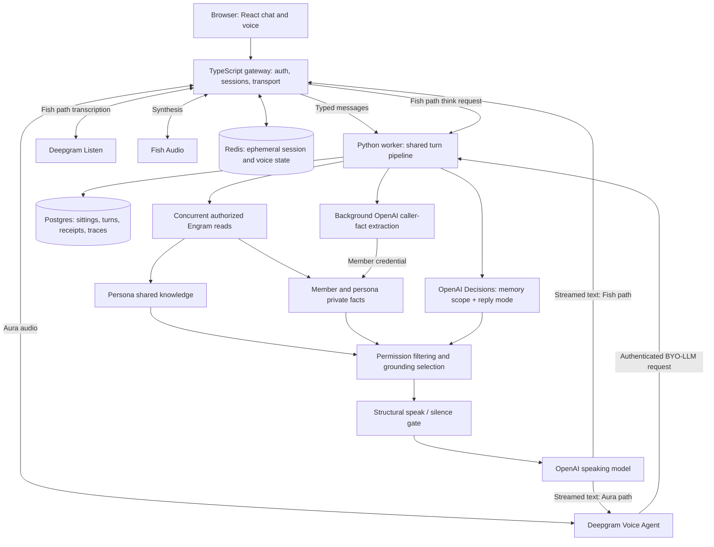

# Voice Persona

### A voice, a memory, and the judgment to know what comes next.

**Live demo:** [talk to a persona at bot.metacog.in](https://bot.metacog.in)

Voice Persona gives AI personas continuity: a distinct voice, knowledge you can teach, and private
memories of the people they meet. Built for creators, educators, and teams, it combines OpenAI
language models with Engram, our company's persistent memory platform, to carry useful context
across conversations. Our OpenAI Decisions API integration makes two contextual choices in one
request: which authorized memories should inform the reply, and whether the moment needs an answer
or a brief acknowledgment. Fish Audio brings those responses to life through speech. The result is
a foundation for personal guides, creator personas, and product experts that remember your context
while keeping each caller's memories separate.

Talking to a persona is a conversation you can come back to. You sign in, choose someone an owner
has taught, and speak or type. It answers in that persona's voice. You might say what you are
working on, ask for their perspective, or pick up a thread from last time without introducing
yourself again. Someone else talking to the same persona gets the same shared knowledge, and a
private memory of their own.

Deepgram handles speech recognition and Aura voices. Fish Audio is the alternative when a persona
uses a cloned voice.

[Live demo](https://bot.metacog.in) · [Architecture](#architecture) ·
[OpenAI Decisions](#openai-decisions-two-choices-one-request) ·
[Engram memory](#engram-memory-that-survives-the-call) · [Run locally](#run-locally) ·
[Validation](#implementation-and-validation)

## The experience

Imagine teaching a persona your background, ideas, and expertise, then letting someone talk to it.
A caller introduces themselves, shares what they are working on, and asks for your perspective. On
a later visit they can say "where did we leave my project?" and the persona still has the facts
worth keeping. Another caller meets the same persona, with the same shared knowledge, but has
their own private history. Talking to the persona never opens someone else's memories.

That experience brings together three separate responsibilities:

- **Remember:** preserve useful facts across sessions, with a boundary between the persona's
  knowledge and each caller's information.
- **Decide:** select the relevant memory sources and distinguish a request that needs an answer
  from a moment that needs a brief acknowledgment.
- **Speak:** generate a grounded reply with OpenAI and stream it into the persona's chosen voice.

The owner can create or link personas, teach them, ingest knowledge, publish them, and manage
access through `/admin/persona`. Members sign in with Google, choose a published persona, and
use `/chat` or `/voice`. The app also includes a personal dashboard, conversation history, a private
memory view, account data controls, quotas, a waitlist, and public service status.

## OpenAI Decisions: two choices, one request

The integration calls **`client.decisions.create(...)`** through the OpenAI SDK. When both features
are enabled and eligible, two independent questions share one contextual request alongside memory
retrieval. This uses the API's support for [multiple independent questions over shared
input](https://developers.openai.com/api/docs/guides/decisions#ask-multiple-questions).

### 1. Which memory belongs in this reply?

The memory decision chooses **`shared`**, **`private`**, or **`both`**:

- “What inspired your work?” should draw on the persona's shared knowledge.
- “What project did I tell you about?” should draw on that caller's private memory.
- “How would your experience help with my project?” may need both.

These are illustrative expectations, not keyword rules. The model receives the current turn,
bounded recent history, persona identity, and application context. Retrieved memory contents and
credentials are not included in the Decisions payload.

The worker starts the authorized shared and private reads concurrently with the decision. It then
checks the returned memory rows and applies the choice to the labelled lists passed to the answerer.
**The decision can remove a memory source; it cannot grant access to one.** This implementation
selects grounding for generation; it does not claim to eliminate either retrieval request.

Low confidence, a timeout, refusal, malformed output, or provider failure keeps both **authorized**
sources available. Missing member credentials still means shared-only access.

### 2. Does this moment need an answer or an acknowledgment?

The conversational decision chooses **`answer`** or **`acknowledge`**:

- A factual question or actionable request calls for an answer.
- A simple thank-you or social closing can receive a short acknowledgment.
- A disclosure followed by a question must still get an answer.
- A contextual “yes, please” is interpreted with recent conversation history.

The choice becomes a hint to the existing OpenAI speaking model. Acknowledgments are generated
in context, rather than selected from canned phrases. Both modes use the same response stream;
there is no second speaking-model pass. Uncertain decisions fall back to answering.

The structural controller still determines whether speech is eligible. This feature does not
implement waiting, microphone endpointing, echo detection, or permission checks.

### Built to inspect and roll back

Each feature has independent **off**, **shadow**, and **active** modes. Shadow mode records
candidates without applying them; when all enabled Decisions features are in shadow, the turn does
not wait for the result. Active use has bounded input, bounded concurrency, one deadline, no
automatic retries, and per-question fallback handling. Logs distinguish candidate decisions from
the mode actually applied to the turn.

**Both integrations are implemented and live-probed. They are disabled by default while manual
product acceptance, threshold approval, and paired latency validation remain open.**

Explore the implementation:
[adapter](worker/src/worker/decisions/client.py),
[context](worker/src/worker/decisions/context.py),
[memory policy](worker/src/worker/decisions/routing.py),
[conversation policy](worker/src/worker/decisions/conversation.py), and
[turn orchestration](worker/src/worker/turn/service.py).

## Architecture



### One brain, two speech paths

**Aura:** the browser streams audio through the gateway to Deepgram Voice Agent. Deepgram calls
our authenticated OpenAI-compatible BYO-LLM endpoint for the reply, and synthesizes the streamed
text with Aura. Local development needs a publicly reachable think URL.

**Fish:** Deepgram Listen transcribes the caller. The gateway calls the worker, forwards generated
text to hosted Fish Audio, and sends synthesized audio to the browser. The provider is selected
explicitly per persona. A failed Fish configuration does not silently switch the persona to Aura.

Typed chat uses the same worker and memory boundaries. Transport interruption handling remains
separate from language decisions; loudspeaker echo and real-device behavior still need the
[documented device checks](docs/plans/voice-audio.md).

### OpenAI's role beyond Decisions

The default `BRAIN_MODE=retrieve` path uses **OpenAI for response generation** from labelled persona
and caller memories, current conversation context, and the optional reply-mode hint. OpenAI also
extracts durable caller facts in the background. The alternate `BRAIN_MODE=chat` delegates persona
answer generation to Engram and reframes the result; Decisions integration targets the retrieve path.

Model selection is configuration: `OPENAI_MODEL` defaults to `gpt-4o-mini`, `CALLER_FACT_MODEL` can
override the extraction model, and `DECISIONS_MODEL` defaults to `gpt-6-luna`. These are repository
defaults, not a claim about a particular running deployment. The Decisions client has its own key
and base-URL settings and does not inherit a custom speaking-model endpoint.

## Engram: memory that survives the call

**Engram is our company's memory product, and this application demonstrates it in a voice
experience.** It supplies the persistent memory service; this repository contains the application
and its integration, rather than the Engram service itself.

Engram separates a vector-and-graph memory core from a backend responsible for authentication,
permissions, tenant isolation, metering, and auditing. That separation lets this app use memory
operations while Engram enforces the service-side access boundary.
[Engram architecture](https://engram-docs-alpha.netlify.app/concepts/architecture).

### Shared identity, private relationships

Every persona has two kinds of memory:

**Shared persona knowledge** contains owner-taught background, expertise, and ingested material.
Subscribers can retrieve it. The owner manages that knowledge through persona teaching and shared
pool ingestion APIs.

**Private caller memory** contains useful facts a particular member shared with that particular
persona. Another member cannot read those facts. The same member talking to another persona has
a separate private pool. Authorized workspace administration is a distinct surface.

Engram exposes these through persona endpoints. A retrieved memory carries its own `tenant` and
`gid`; a `gid` alone is insufficient because pools number their memories independently. The app
preserves that source information when checking and recording grounding.
[Engram persona and tenant contracts](https://engram-docs-alpha.netlify.app/llms.txt).

### What happens when a caller shares something worth remembering?

1. The app records the sitting and actual utterances in **Postgres**.
2. A background **OpenAI caller-fact extractor** identifies useful caller facts. An additional
   extraction pass runs when the sitting ends.
3. Eligible facts are written as text through Engram's persona-private ingestion surface using
   that member's credential. Extraction failure writes nothing from that pass.
4. A later turn retrieves relevant shared knowledge and private facts into separately labelled
   lists. The answerer can distinguish what the persona knows from what the caller said.
5. When enabled, OpenAI Decisions selects which authorized lists should ground the reply.

For example, “I am preparing my first robotics workshop” can become a private caller fact. A later
question about that workshop can use it alongside the persona's teaching experience. This is an
illustrative flow; successful recall depends on extraction, ingestion, and retrieval completing.

The default retrieve path sends **text facts**, not microphone recordings or a verbatim transcript,
to Engram. Dates attached to extracted facts help the answerer interpret later updates; they do not
constitute a separate contradiction-resolution engine. A spoken acknowledgment is not confirmation
that an asynchronous memory write has completed.

### Why the credential matters

Binding a user ID in an SDK client is not enough: Engram's persona-private operations resolve the
caller from the authenticated principal. The worker therefore obtains a member-specific session
token. If it cannot credential that member, it uses shared knowledge only, rather than falling back
to the organization key's private memory.

Session ownership, persona pinning, and returned-row permission checks add application-side
boundaries. The model never constructs tenant addresses or decides who is authorized. The full
integration contract and its verification history live in
[`docs/architecture/memory.md`](docs/architecture/memory.md).

### Memory service versus application storage

Engram documents relevance-ranked retrieval, absorption of duplicate content, and conversation
compression into episodes. Its broader platform also supports multimodal ingestion. Those are
platform capabilities; this app's default caller-memory path deliberately uses extracted text facts,
with exact transcripts retained in Postgres.
[Engram platform documentation](https://engram-docs-alpha.netlify.app/llms.txt).

Storage responsibilities remain explicit: **Engram** holds durable persona and caller knowledge;
**Postgres** holds application records and transcripts; **Redis** holds temporary session and voice
state. Optional Azure Blob audio archiving is disabled by default.

## Implementation and validation

The repository includes working chat and voice paths, persona management, caller-fact extraction,
and the two Decisions integrations. Automated coverage exercises parsing, deadlines, failures,
independent feature modes, grounding boundaries, stream integration, and persistence.

Live synthetic calibration is recorded in the repository. In the combined 14-case repeat, candidate
thresholds of `0.9` for memory scope and `0.8` for acknowledgment produced zero incorrect scope
narrowings and zero unanswered-request errors, with conservative fallbacks. An earlier run with a
lower scope threshold produced two incorrect narrowings; both runs are retained. This small fixture
is evidence for further testing, not a general accuracy claim or production threshold approval.

- [Memory-routing evidence and manual checks](docs/tests/decisions-memory-routing.md)
- [Conversational evidence and manual checks](docs/tests/decisions-conversation.md)
- [Full test and probe catalogue](docs/tests/README.md)

Real `/chat`, Aura, and Fish acceptance sittings and comparable feature-off/feature-on first-word
measurements remain pending. See [current progress](docs/progress.md) for the complete status.

### Where we take Decisions next

Two extensions are designed as future work and **are not implemented**:

- **Memory validation:** assess extracted candidate facts for support, attribution, and durability
  before admission to private memory. The generative extractor still produces the fact text.
- **Persona and memory quality evaluation:** score curated or recorded replies for grounding,
  caller/persona attribution, and conversational appropriateness to compare prompts and models.

These extend the same idea: use explicit model decisions at important boundaries, with evidence
and fallbacks. Scope is recorded in the [Decisions plan](docs/plans/openai-decisions.md).

## Run locally

Requires Node 22+, Python 3.12 managed by uv, and Docker. From the repository root:

```bash
cp .env.example .env
# Fill in the required credentials before starting services.
npm install
uv sync --directory worker
npm run infra:up
npm run migrate
```

Run each process in its own terminal:

```bash
npm run dev:gateway
npm run dev:worker
npm run dev:frontend
```

Open the configured frontend origin (default `http://localhost:5188`). Google OAuth is required
for sign-in and gateway startup; Engram and OpenAI credentials are needed for the live brain.
Deepgram is required for spoken calls, with a Fish key additionally required for Fish personas.
Aura calls need `BYO_LLM_PUBLIC_URL` reachable by Deepgram. Fish calls reach the worker from the
gateway through `WORKER_URL`.

### Observe Decisions before activation

With account access to the Decisions API and `DECISIONS_API_KEY` or `OPENAI_API_KEY` configured,
these settings enable shadow observation on the retrieve brain:

```dotenv
BRAIN_MODE=retrieve
ENGRAM_SCOPE_ROUTER_ENABLED=true
ENGRAM_SCOPE_ROUTER_BACKEND=decisions
DECISIONS_SCOPE_MODE=shadow
CONVERSATION_DECISIONS_MODE=shadow
```

Restart the worker after changing configuration. Active mode also needs explicit confidence
thresholds; follow the linked manual checks before selecting them. All knobs are documented in
[`.env.example`](.env.example). Returning each mode to `off` independently rolls back its behavior.

Run the read-only combined synthetic probe:

```bash
uv run --directory worker python -m worker.decisions.probe \
  --question-set both --threshold 0.9 --conversation-threshold 0.8
```

Those are calibration candidates, not approved production values. The probe calls OpenAI but does
not write to Engram or create app conversations.

Useful verification commands:

```bash
npm run smoke
npm run typecheck
npm run lint
npm test
npm run security
npm run failures
npm run bargein
```

## Repository and further reading

- [`frontend/`](frontend/) — React 18, Vite, Tailwind, chat, voice, member and owner interfaces.
- [`gateway/`](gateway/) — TypeScript/Fastify, Google auth, HTTP/WebSocket transport, speech providers.
- [`worker/`](worker/) — Python/FastAPI, OpenAI, Decisions, Engram, controller, extraction, BYO-LLM.
- [`infra/`](infra/) — local Postgres/Redis, migrations, container and Azure deployment resources.
- [`docs/README.md`](docs/README.md) — documentation map.
- [`docs/architecture.md`](docs/architecture.md) — detailed runtime architecture and data model.
- [`docs/architecture/voice-audio.md`](docs/architecture/voice-audio.md) — capture, playback, interruption.
- [`docs/ops/deploy.md`](docs/ops/deploy.md) — production topology and deployment procedure.

The deployment design uses one public origin with an nginx edge, gateway, and worker in Azure
Container Apps, backed by managed Postgres and Redis. Provisioning and operational status are
tracked separately from implementation; the deployment guide is the source for running it.
